# moodtube-themes

Каталог тем для расширения [**MoodTube**](https://github.com/moonnsy/MoodTube) (SillyTavern). Выберите тему из списка и установите её одним нажатием, без поиска файлов по файлообменникам.

<p align="center">
  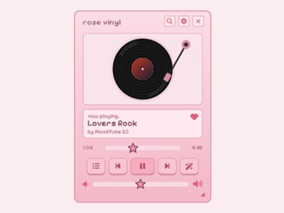
  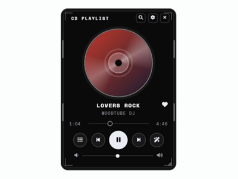
  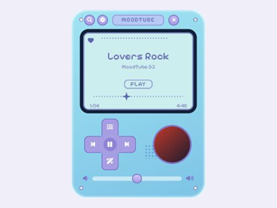
  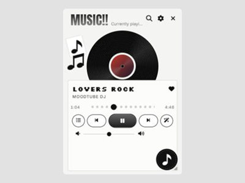
  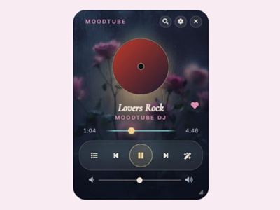
</p>

## Как подключить каталог

1. В SillyTavern откройте **MoodTube → Настройки → Интерфейс** и выберите **Тема оформления: Custom**.
2. В поле **«Каталог тем (ссылка на index.json)»** вставьте:

   ```
   https://raw.githubusercontent.com/ann22cadis/moodtube-themes/main/index.json
   ```

   Запасная ссылка через CDN (иногда открывается там, где не открывается raw):

   ```
   https://cdn.jsdelivr.net/gh/ann22cadis/moodtube-themes@main/index.json
   ```
3. Нажмите **«Загрузить»**, выберите тему и нажмите **«Установить»**. Тема сразу применится для просмотра.
4. Понравилась, нажмите **«Сохранить»** внизу окна настроек. Не понравилась, выберите другую или закройте окно без сохранения.

Нужна версия [расширения MoodTube](https://github.com/moonnsy/MoodTube), в которой есть поле «Каталог тем». Если его нет, обновите MoodTube (в SillyTavern: Расширения → Управление расширениями → обновить, либо `git pull` в папке расширения).

## Темы

### Vinyl: пиксельный плеер с пластинкой и тонармом

Светлые:

<table>
  <tr>
    <td align="center"><br><b>Rose</b><br>розовый</td>
    <td align="center">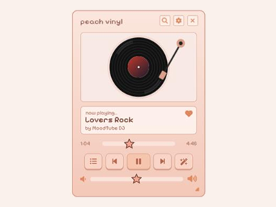<br><b>Peach</b><br>персиковый</td>
    <td align="center">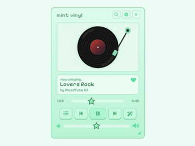<br><b>Mint</b><br>мятный</td>
  </tr>
  <tr>
    <td align="center">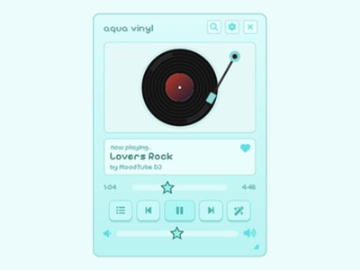<br><b>Aqua</b><br>бирюзовый</td>
    <td align="center">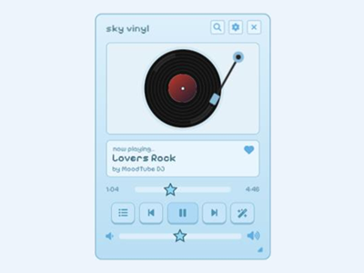<br><b>Sky</b><br>небесно-голубой</td>
    <td align="center">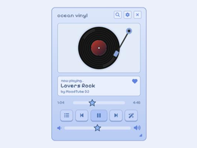<br><b>Ocean</b><br>васильковый</td>
  </tr>
  <tr>
    <td align="center">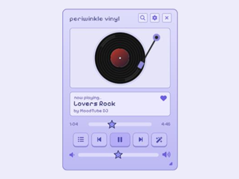<br><b>Periwinkle</b><br>сиренево-синий</td>
    <td align="center">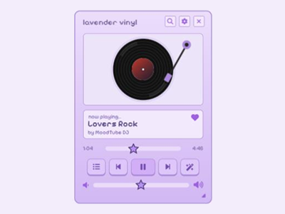<br><b>Lavender</b><br>лавандовый</td>
    <td align="center">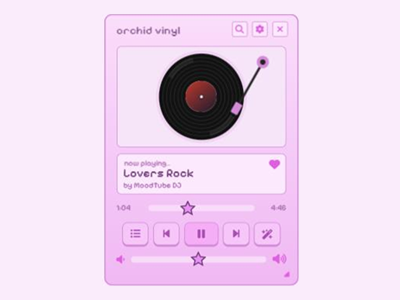<br><b>Orchid</b><br>орхидея</td>
  </tr>
</table>

Тёмные:

<table>
  <tr>
    <td align="center">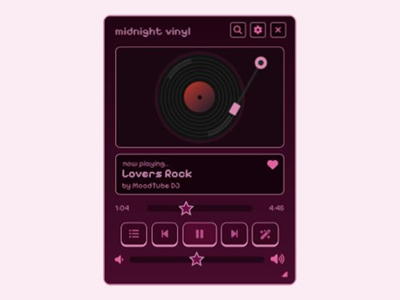<br><b>Midnight</b><br>бордово-сливовый</td>
    <td align="center">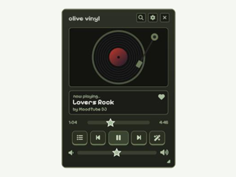<br><b>Olive</b><br>оливковый</td>
    <td align="center">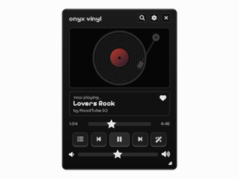<br><b>Onyx</b><br>чёрный</td>
    <td align="center">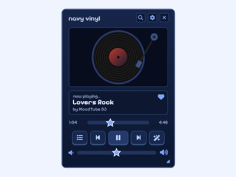<br><b>Navy</b><br>тёмно-синий</td>
    <td align="center">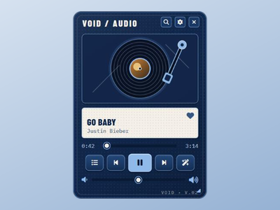<br><b>Void</b><br>синий проигрыватель с тонармом</td>
  </tr>
</table>

### Остальные

<table>
  <tr>
    <td align="center" width="33%">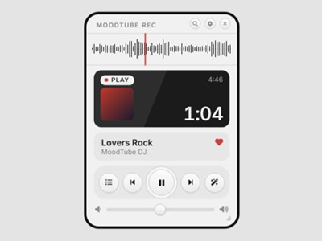<br><b>Field Recorder</b><br>светлый диктофон: волна вместо прогресса с красной линией, тёмный экранчик с таймером</td>
    <td align="center" width="33%"><br><b>Crystal Handheld</b><br>полупрозрачная голубая консоль, пиксельный экран, крестовина, обложка-кнопка</td>
    <td align="center" width="33%"><br><b>Jewel Case</b><br>чёрный футляр от CD с прозрачными уголками и большим диском</td>
  </tr>
  <tr>
    <td align="center"><br><b>Paper Sleeve</b><br>чёрно-белый коллаж: пластинка в белом конверте, бумажные нотки</td>
    <td align="center"><br><b>Rain Roses</b><br>фото роз за дождливым стеклом, матовое стекло, янтарные акценты</td>
    <td align="center">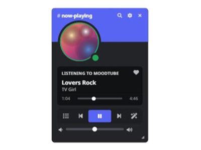<br><b>Blurple</b><br>карточка профиля как в чат-приложении: обложка-аватарка со статусом, карточка «Listening to», панель кнопок как в голосовом канале</td>
  </tr>
</table>

### Clear Case: прозрачная коробка с диском

Обложка трека печатается на диске и крутится, пока играет музыка. В большом окне текст слева, коробка справа.

<table>
  <tr>
    <td align="center" width="25%">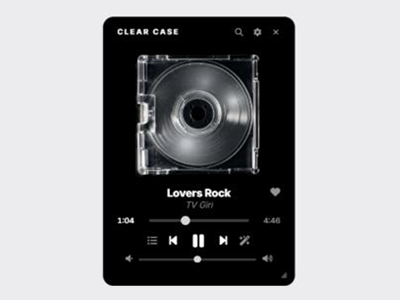<br><b>Clear Case</b><br>чёрно-белая</td>
    <td align="center" width="25%">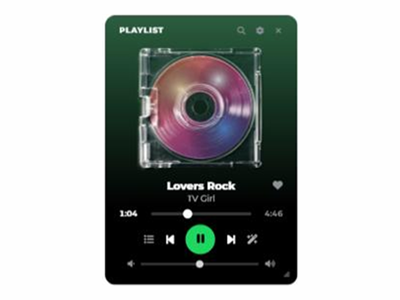<br><b>Playlist</b><br>как обложка плейлиста, зелёная кнопка Play</td>
    <td align="center" width="25%">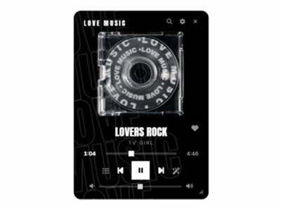<br><b>Love Music</b><br>контурные буквы на фоне, надпись по кругу диска</td>
    <td align="center" width="25%">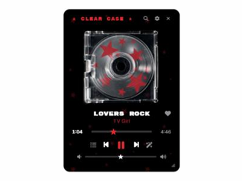<br><b>Red Stars</b><br>красные звёзды, ползунки-звёздочки</td>
  </tr>
  <tr>
    <td align="center">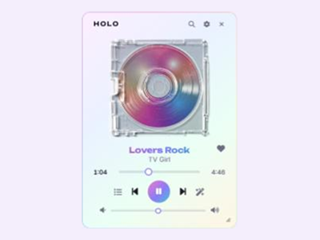<br><b>Holo</b><br>светлая, радужная рамка, голографический диск</td>
    <td align="center">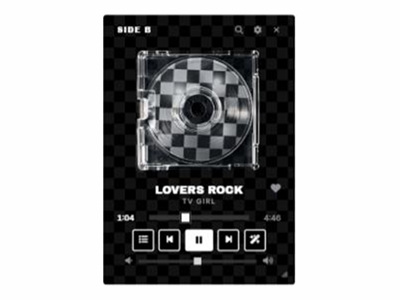<br><b>Checker</b><br>шахматка, квадратные кнопки</td>
    <td align="center">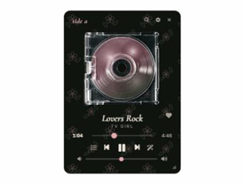<br><b>Faded Floral</b><br>цветочные обои, курсив с засечками</td>
    <td align="center">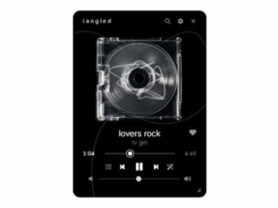<br><b>Tangled</b><br>провод наушников на диске и фоне</td>
  </tr>
</table>

### Let's Go Gambling

<table>
  <tr>
    <td align="center">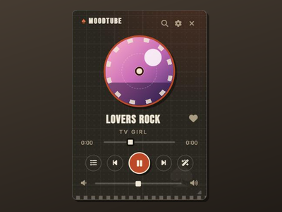<br><b>Let's Go Gambling</b><br>казино: обложка-покерная фишка, пиковая масть, клетчатый тёмный фон, оранжевый акцент</td>
  </tr>
</table>

### Кассеты

<table>
  <tr>
    <td align="center">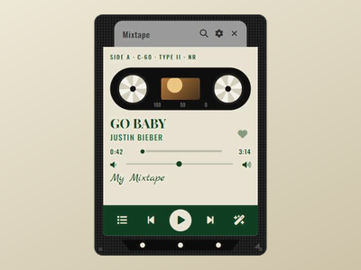<br><b>Cassette Tape</b><br>кассета: наклейка с надписями, крутящиеся бобины, зелёная полоса кнопок</td>
    <td align="center">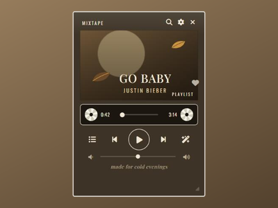<br><b>My Fall Life</b><br>коричневый кейс, лента-прогресс с бобинами, треклист в очереди</td>
  </tr>
</table>

### Sweet Universe

<table>
  <tr>
    <td align="center">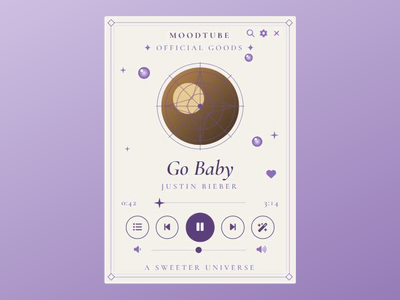<br><b>Sweet Universe: Memo</b><br>кремовый лист, медальон из геометрии, планеты</td>
    <td align="center">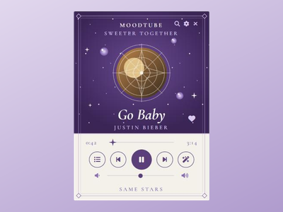<br><b>Sweet Universe: Night</b><br>звёздный сливовый верх, кремовый низ</td>
  </tr>
</table>

### Хэллоуинские марки

<table>
  <tr>
    <td align="center">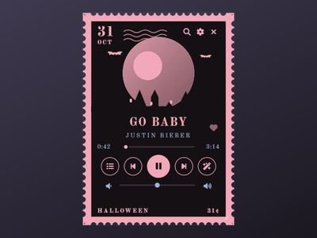<br><b>Stamp: Haunted Moon</b><br>розовая марка: обложка-луна, замок, летучие мыши, штемпель</td>
    <td align="center">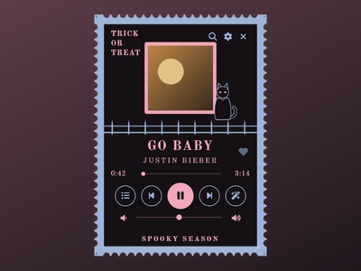<br><b>Stamp: Trick or Treat</b><br>голубая марка: кот на ограде, обложка в розовой рамке</td>
  </tr>
</table>

### PowerShell Neofetch

Окно терминала: вкладка pwsh, рамка с заголовком, строки TRACK и ARTIST, прогресс и громкость блоками. Пять цветов.

<table>
  <tr>
    <td align="center">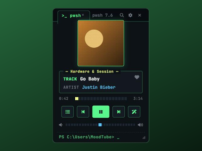<br><b>Green</b></td>
    <td align="center">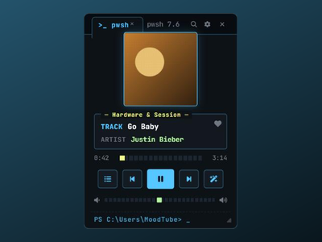<br><b>Cyan</b></td>
    <td align="center">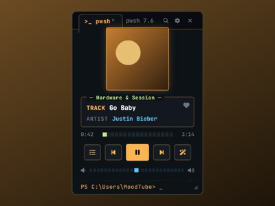<br><b>Amber</b></td>
    <td align="center">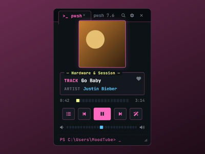<br><b>Pink</b></td>
    <td align="center">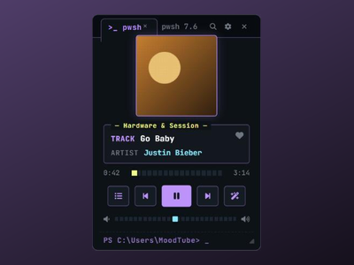<br><b>Violet</b></td>
  </tr>
</table>

### Green Terminal

<table>
  <tr>
    <td align="center">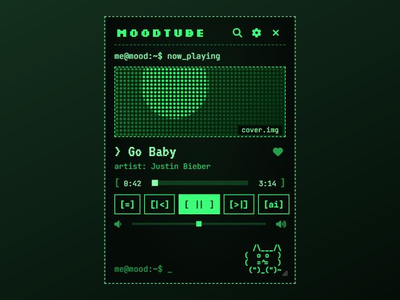<br><b>Green Terminal</b><br>зелёный терминал: кнопки в скобках, растровая обложка, ASCII-котик, очередь как лог</td>
  </tr>
</table>

### Halftone Bloom: постер с растровым цветком

Обложка трека превращается в точечный растр, по бокам колючие ветки, название крупным рукописным шрифтом, статус на наклейке-звёздочке.

<table>
  <tr>
    <td align="center" width="20%">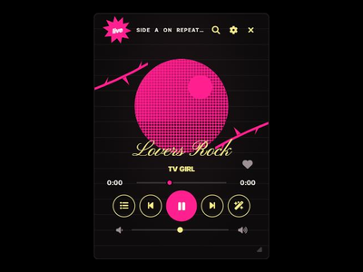<br><b>Magenta</b></td>
    <td align="center" width="20%">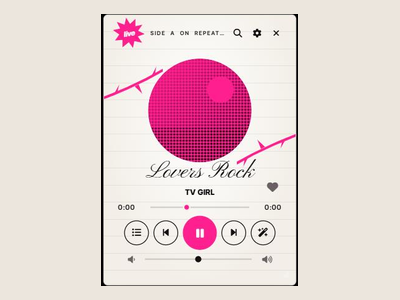<br><b>Paper</b></td>
    <td align="center" width="20%">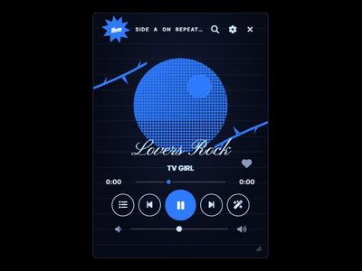<br><b>Blue</b></td>
    <td align="center" width="20%">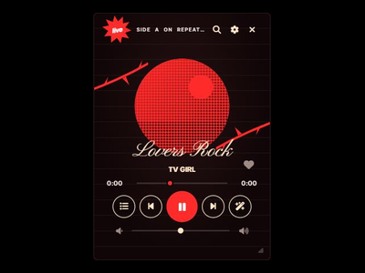<br><b>Red</b></td>
    <td align="center" width="20%">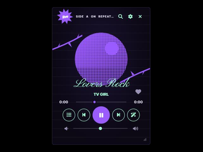<br><b>Violet</b></td>
  </tr>
</table>

### Праздничные: Pumpkin Night и Midnight Snow

<table>
  <tr>
    <td align="center" width="50%">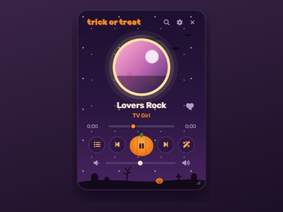<br><b>Pumpkin Night</b><br>Хэллоуин: обложка-луна, летучие мыши, кладбище на холме, Play-тыква</td>
    <td align="center" width="50%">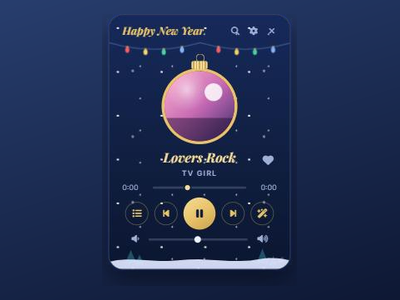<br><b>Midnight Snow</b><br>Новый год: падающий снег, гирлянда, обложка-ёлочная игрушка</td>
  </tr>
</table>

### Pink CRT и Pink Scrapbook

<table>
  <tr>
    <td align="center" width="50%">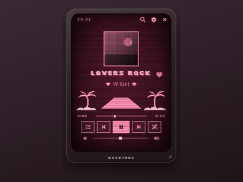<br><b>Pink CRT</b><br>розовый ЭЛТ-телевизор: строки развёртки, пиксельный пейзаж с пальмами</td>
    <td align="center" width="50%">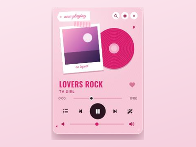<br><b>Pink Scrapbook</b><br>розовый коллаж: бирка от руки, полароид со скотчем, малиновый диск</td>
  </tr>
</table>

### Pink Mixtape и Recent Favs Zine

<table>
  <tr>
    <td align="center" width="50%"><br><b>Pink Mixtape & Vinyl</b><br>тёмный плеер, неоново-розовый акцент, винил с обложкой</td>
    <td align="center" width="50%"><br><b>Recent Favs Zine</b><br>светлый бумажный зин: пластинка с постером-обложкой, рамка вокруг названия</td>
  </tr>
</table>

Все темы адаптируются под размер плеера: обычный, широкий (горизонтальная полоса) и узкий. Окно настроек, очередь, поиск и плейлисты оформлены в том же стиле.

## Установка вручную

Если каталог не открывается: скачайте нужный файл из папки [`themes/`](themes) и загрузите через **Custom → Импорт** в настройках MoodTube.

## Что важно знать

- Во всех темах оформлена и полоса под шапкой Таверны («Интерфейс → Вид плеера → Шапка сверху»), вместе с раскрывающейся под ней панелью плеера.
- Темы используют шрифты Google Fonts (подгружаются при открытии плеера). Без интернета будет запасной шрифт, остальное выглядит так же.
- Тема **Rain Roses** берёт фон-картинку по внешней ссылке. Если картинка станет недоступной, останется тёмный фон.
- Картинка коробки для всех тем **Clear Case** лежит здесь же, в папке [`assets/`](assets).
- Тема содержит только CSS, цвета и картинки, исполняемого кода в ней нет. Перед установкой MoodTube показывает предупреждение о внешнем источнике.

## Формат каталога

Каталог это обычный `index.json`:

```json
{
    "type": "moodtube_catalog",
    "version": 1,
    "name": "moodtube-themes",
    "themes": [
        {
            "id": "rose-vinyl",
            "name": "Rose Vinyl",
            "author": "ann22cadis",
            "description": "Пиксельный плеер с виниловой пластинкой и тонармом, розовый.",
            "file": "themes/rose-vinyl.json",
            "preview": "previews/rose-vinyl.png",
            "tags": ["pixel", "vinyl", "light"],
            "version": 1
        }
    ]
}
```

`file` и `preview` можно указывать относительными путями (от адреса `index.json`) или полными ссылками. Сами темы в формате `moodtube_theme` (версия 2). MoodTube принимает ссылки только `https` с `raw.githubusercontent.com`, `cdn.jsdelivr.net`, `gist.githubusercontent.com` и `*.github.io`. Свой каталог можно завести по тому же образцу.

## Добавить свою тему

1. Положите файл темы в `themes/`, превью (квадрат, например 400×400) в `previews/`.
2. Добавьте запись в `index.json`.
3. Отправьте pull request или напишите в issues.

## English

Theme catalog for the [**MoodTube**](https://github.com/moonnsy/MoodTube) SillyTavern extension. In MoodTube → Settings → Interface → set the theme to *Custom*, paste `https://raw.githubusercontent.com/ann22cadis/moodtube-themes/main/index.json` into the *Theme catalog* field, press *Load*, then *Install* a theme and *Save*. Themes are plain CSS + colors + images (no scripts).
